# ЕВРО СТЕКЛО — процесс верхнего уровня: как есть, как хочет, разрыв и вопросы

**Дата**: 2026-09-28 · **Вид**: сводный документ (КТ-1, спецификация 002, FR-101…FR-105)
**Источники**: `docs/process/work/p-a-tobe.md` (как хочет клиент, доска Miro), `p-b-asis.md` (как сейчас, видео/кадры портала), `p-c-risks.md` (риски, критика пакета 001). Метки: `PROVEN` — прямо из источника · `INFERRED` — из двух и более · «Информации нет» — источник молчит · `БЛОКИРОВАНО В№` — нет источника, блокировано до ответа клиента (закон блокировки `AGENTS.md`).

## 1. Коротко о документе

Это взгляд на то, как компания ведёт заказ — от первого обращения до установки и контрольных звонков. Подтверждено, что у клиента есть намерение вести сквозной путь по этапам с ясными документами и напоминаниями на каждом шаге. Подтверждено также, что на практике большая часть заявок застревает на первых этапах и в производстве, а ключевые исполнители (кто едет на замер, кто ведёт производство, кто фиксирует завершение) нигде не зафиксированы. Документ показывает намерение, фактическое состояние и разрыв между ними; всё, что не имеет подтверждения, помечено как `БЛОКИРОВАНО` с номером вопроса — до встречи с клиентом. Ни одна незакрытая точка не додумана за клиента.

## 2. Схема процесса верхнего уровня

Сплошная линия `-->` — переход подтверждён (есть связь на доске). Пунктир `-.->` с `В№` — переход не подтверждён, блокирован до ответа клиента. Роль подписана у каждого шага; каким должностям, отделам и сотрудникам соответствует каждая роль на схеме — вопрос `В22`.

```mermaid
flowchart LR
  S1["1. Обращение клиента<br/>(представитель канала)"]
  S2["2. Взятие в работу, реквизиты<br/>(кто: В1)"]
  S3["3. Счёт на замер<br/>(Менеджер отдела продаж)"]
  S4["4. Задание на замер, оценка<br/>(Менеджер отдела продаж)"]
  S5["5. Замер, проектирование, документы<br/>(Руководитель проектного отдела)"]
  S6["6. Коммерческое предложение<br/>(кто: В6)"]
  S7["7. Подготовка договора<br/>(Менеджер отдела продаж)"]
  S8["8. Подписание договора<br/>(Менеджер отдела продаж)"]
  S9["9. Предоплата<br/>(Менеджер отдела продаж)"]
  S10["10. Оформление в производство<br/>(Менеджер отдела продаж)"]
  S11["11. Запуск и график<br/>(Руководитель ПТО)"]
  S12["12. Обеспечение материалами<br/>(Менеджер ОП, Руководитель снабжения)"]
  S13["13. Производство<br/>(производство)"]
  S14["14. Отгрузка<br/>(Менеджер отдела продаж)"]
  S15["15. Завершение сделки<br/>(Ассистент отдела продаж)"]
  S16["16. Сервис — звонки<br/>(Ассистент отдела продаж)"]
  S17["17. Монтаж<br/>(Руководитель службы сервиса)"]
  O["Отказы<br/>(откуда: В21)"]

  S1 -.->|В1| S2
  S2 -.->|В1| S3
  S3 --> S4
  S4 --> S5
  S5 -.->|В5| S6
  S6 -.->|В8| S7
  S7 -.->|В8| S8
  S8 -.->|В8| S9
  S9 -.->|В10| S10
  S10 -.->|В11| S11
  S11 -.->|В11| S13
  S12 -.->|В13| S13
  S13 -.->|В16| S14
  S14 -.->|В16| S15
  S15 -.->|В17| S16
  S17 -.->|В18| S15
  S1 -.->|В21| O
```

Шаг 12 «Обеспечение материалами» идёт параллельно запуску в производство (шаги 10→11→13). Шаг 17 «Монтаж» — отдельная ветка к завершению (15); его точное место не подтверждено.

## 3. Шаги процесса

Для каждого шага: как сейчас · как хочет клиент · разрыв · что известно (источник) · что неизвестно (БЛОКИРОВАНО В№) · варианты для обсуждения · вопросы по шагу.

### Шаг 1 — Обращение клиента и создание записи

- **Как сейчас**: портал принимает обращения из разных каналов (авито, звонки, приложение, почта). Часть без ответственного, «Не обработано» 982, «В работе» 291, «Обработано» 1552 (`PROVEN`, p-b: Шаг 1).
- **Как хочет клиент**: обращение фиксируется, дальше берётся в работу; на доске четыре салона и внешние каналы (`PROVEN`, p-a: Шаг 1).
- **Разрыв**: входящие фактически не разбираются (982 без обработки, «за ними не следят»), точка входа не даёт результата.
- **Что известно**: каналы и запись — `PROVEN` (p-a: Шаг 1); 982 необработанных — `PROVEN` (p-b: Шаг 1, речь 00:00:07).
- **Что неизвестно — БЛОКИРОВАНО**: кто и в какой срок принимает обращение в работу и вносит реквизиты — `В1` (вопрос один для шагов 1–2); какие каналы и как разносить — `В2`.
- **Варианты для обсуждения (2–3, не факт)**:
  - Срок обработки входящего (N часов) и закреплённый ответственный. Плюсы: заявки не остывают. Минусы: нужен исполнитель. Последствия: меньше потерянных обращений. вариант для обсуждения, не факт.
  - Распределить каналы между салонами. Плюсы: ясная ответственность. Минусы: неравномерная нагрузка. Последствия: руководитель знает, кого спросить. вариант для обсуждения, не факт.
  - Ежедневный разбор незакрытых входящих руководителем. Плюсы: контроль. Минусы: ручная дисциплина. Последствия: меньше бездействующих. вариант для обсуждения, не факт.
- **Вопросы по шагу**: `В1`, `В2`.

### Шаг 2 — Взятие обращения в работу и реквизиты контрагента

- **Как сейчас**: заявки копятся на этапе «Первичная заявка» — 1166 на 60,3 млн ₽, а на следующий почти не переходят (на замере 17) (`PROVEN`, p-b: Шаг 2).
- **Как хочет клиент**: обращение берётся в работу с реквизитами по единому формату (`PROVEN`, p-a: Шаг 2).
- **Разрыв**: единого формата и действия «взять в работу» нет — заявки без движения.
- **Что известно**: единый формат — `PROVEN` (p-a: Шаг 2); 1166 на первом этапе — `PROVEN` (p-b: Шаг 2).
- **Что неизвестно — БЛОКИРОВАНО**: кто и в какой срок принимает обращение в работу и вносит реквизиты — `В1` (вопрос один для шагов 1–2).
- **Варианты для обсуждения (2–3, не факт)**:
  - Закрепить роль за каждым каналом. Плюсы: понятные ответственные. Минусы: нужен штат. Последствия: обращение не зависает. вариант для обсуждения, не факт.
  - Обязательный перечень реквизитов для открытия заказа. Плюсы: полнота данных. Минусы: больше ручной работы. Последствия: единые карточки. вариант для обсуждения, не факт.
  - Еженедельная сверка необработанных заявок. Плюсы: регулярный контроль. Минусы: ручной процесс. Последствия: заявки не теряются. вариант для обсуждения, не факт.
- **Вопросы по шагу**: `В1`.

### Шаг 3 — Предварительный расчёт: счёт на замер и контроль оплаты

- **Как сейчас**: отдельного этапа «счёт за замер» нет; на замере 17 заказов (`PROVEN`, p-b: Шаг 3, 5).
- **Как хочет клиент**: клиенту отправляется счёт на оплату выезда на замер, оплата контролируется (`PROVEN`, p-a: Шаг 3).
- **Разрыв**: плата за замер не зафиксирована как обязательное условие (p-c: R5); в какой момент её брать и кто проверяет поступление — не подтверждено (`БЛОКИРОВАНО В3`).
- **Что известно**: счёт и контроль — `PROVEN` (p-a: Шаг 3); этапа нет и плата не привязана к этапу — `PROVEN` (p-b: Шаг 3; p-c: R5).
- **Что неизвестно — БЛОКИРОВАНО**: в какой момент брать плату за выезд и кто проверяет её поступление — `В3`.
- **Варианты для обсуждения (2–3, не факт)**:
  - Оплата замера — условие перехода на следующий этап. Плюсы: меньше неоплаченных выездов. Минусы: риск оттока. Последствия: замер оплачивается заранее. вариант для обсуждения, не факт.
  - Явный этап «замер (оплачен)». Плюсы: понятное место. Минусы: больше этапов. Последствия: прозрачный контроль. вариант для обсуждения, не факт.
  - Не брать плату за замер. Плюсы: меньше барьеров. Минусы: затраты компании. Последствия: больше замеров, риск пустых выездов. вариант для обсуждения, не факт.
- **Вопросы по шагу**: `В3`.

### Шаг 4 — Задание на замер и предварительная оценка

- **Как сейчас**: после замера в карточку добавляются данные о размерах; до замера доходит 17 из 1166 заявок (`PROVEN`, p-b: Шаг 3).
- **Как хочет клиент**: формируется задание на замер и получена предварительная оценка (`PROVEN`, p-a: Шаг 4).
- **Разрыв**: задание и оценка как документы в фактической работе (на портале) не прослеживаются.
- **Что известно**: переход счёт→задание — `PROVEN` (p-a: Шаг 4); данные после замера — `PROVEN` (p-b: Шаг 3).
- **Что неизвестно — БЛОКИРОВАНО**: кто выполняет замер и как фиксируется результат — `В4`.
- **Варианты для обсуждения (2–3, не факт)**:
  - Предварительная оценка как отдельный документ с ответственным. Плюсы: единый результат. Минусы: лишний документ. Последствия: ясный ввод в следующий шаг. вариант для обсуждения, не факт.
  - Задание на замер по чек-листу. Плюсы: полнота. Минусы: ручной контроль. Последствия: замер не пропускает позиции. вариант для обсуждения, не факт.
  - Уточнить исполнителя замера и проектирования. Плюсы: закрывает блок. Минусы: нет. Последствия: известен исполнитель. вариант для обсуждения, не факт.
- **Вопросы по шагу**: `В4`.

### Шаг 5 — Замер, проектирование, комплект документов

- **Как сейчас**: на замере 17 заказов; разделы чертежей и расчёта (КП) в карточках пустые (`PROVEN`, p-b: Шаг 3, 4; p-c: R7).
- **Как хочет клиент**: замер и проектирование под контролем руководителя; комплект: чертёж, спецификация фурнитуры, спецификация расходных материалов, монтажная схема, файл чертежа (`PROVEN`, p-a: Шаг 5).
- **Разрыв**: документы заявлены, но не формируются.
- **Что известно**: комплект и контроль — `PROVEN` (p-a: Шаг 5); пустые разделы чертежей и расчёта (КП) — `PROVEN` (p-b: Шаг 4).
- **Что неизвестно — БЛОКИРОВАНО**: кто передаёт документ в продажи — `В5`; где хранятся документы — `В26`.
- **Варианты для обсуждения (2–3, не факт)**:
  - Автоматическое появление документов по итогам проектирования. Плюсы: без ручной работы. Минусы: проверка полноты. Последствия: документы не пустые. вариант для обсуждения, не факт.
  - Формирование по чек-листу с контролем. Плюсы: просто. Минусы: ручная дисциплина. Последствия: документы готовятся людьми. вариант для обсуждения, не факт.
  - Решить единое место хранения документов. Плюсы: не теряются. Минусы: нужен порядок. Последствия: документы доступны. вариант для обсуждения, не факт.
- **Вопросы по шагу**: `В5`, `В26`.

### Шаг 6 — Коммерческое предложение по типовой форме

- **Как сейчас**: раздел расчёта в карточках не заполнен; до согласования доходит 1 заказ (`PROVEN`, p-b: Шаг 4).
- **Как хочет клиент**: предложение по типовой форме с полным перечнем позиций; при понижающих коэффициентах визирование (`PROVEN`, p-a: Шаг 6).
- **Разрыв**: типовой формы и полного перечня нет.
- **Что известно**: правило полноты и визирование — `PROVEN` (p-a: Шаг 6); пустой раздел — `PROVEN` (p-b: Шаг 4).
- **Что неизвестно — БЛОКИРОВАНО**: кто и когда формирует предложение — `В6`; откуда берутся позиции — `В14`.
- **Варианты для обсуждения (2–3, не факт)**:
  - Закрепить владельца и срок подготовки предложения. Плюсы: ответственность. Минусы: загрузка. Последствия: готовится вовремя. вариант для обсуждения, не факт.
  - Брать перечень из единого справочника. Плюсы: нет двойного ввода. Минусы: нужен актуальный справочник. Последствия: меньше ошибок. вариант для обсуждения, не факт.
  - Уточнить ведущий справочник. Плюсы: снимает блок. Минусы: нет. Последствия: единый источник позиций. вариант для обсуждения, не факт.
- **Вопросы по шагу**: `В6`, `В14`.
