# ЕВРО СТЕКЛО — процесс верхнего уровня: как есть, как хочет, разрыв и вопросы

**Дата**: 2026-09-28 · **Вид**: сводный документ (КТ-1, спецификация 002, FR-101…FR-105)
**Источники**: `docs/process/work/p-a-tobe.md` (как хочет клиент, доска Miro), `p-b-asis.md` (как сейчас, видео/кадры портала), `p-c-risks.md` (риски, критика пакета 001). Метки: `PROVEN` — прямо из источника · `INFERRED` — из двух и более · «Информации нет» — источник молчит · `БЛОКИРОВАНО В№` — нет источника, блокировано до ответа клиента (закон блокировки `AGENTS.md`).

## 1. Коротко о документе

Это взгляд на то, как компания ведёт заказ — от первого обращения до установки и контрольных звонков. Подтверждено, что у клиента есть намерение вести сквозной путь по этапам с ясными документами и напоминаниями на каждом шаге. Подтверждено также, что на практике большая часть заявок застревает на первых этапах и в производстве, а ключевые исполнители (кто едет на замер, кто ведёт производство, кто фиксирует завершение) нигде не зафиксированы. Документ показывает намерение, фактическое состояние и разрыв между ними; всё, что не имеет подтверждения, помечено как `БЛОКИРОВАНО` с номером вопроса — до встречи с клиентом. Таких незакрытых точек 26, ни одна не додумана за клиента.

## 2. Схема процесса верхнего уровня

Сплошная линия `-->` — переход подтверждён (есть связь на доске). Пунктир `-.->` с `В№` — переход не подтверждён, блокирован до ответа клиента. Роль подписана у каждого шага; расшифровка ролей — вопрос `В22`.

```mermaid
flowchart LR
  S1["1. Обращение клиента<br/>(представитель канала)"]
  S2["2. Взятие в работу, реквизиты<br/>(кто: В1)"]
  S3["3. Счёт на замер<br/>(Менеджер отдела продаж)"]
  S4["4. Задание на замер, оценка<br/>(Менеджер отдела продаж)"]
  S5["5. Замер, проектирование, документы<br/>(Руководитель проектного отдела)"]
  S6["6. Коммерческое предложение<br/>(кто: В6)"]
  S7["7. Подготовка договора<br/>(Менеджер отдела продаж)"]
  S8["8. Подписание договора<br/>(Менеджер отдела продаж)"]
  S9["9. Предоплата<br/>(Менеджер отдела продаж)"]
  S10["10. Оформление в производство<br/>(Менеджер отдела продаж)"]
  S11["11. Запуск и график<br/>(Руководитель ПТО)"]
  S12["12. Обеспечение материалами<br/>(Менеджер ОП, Руководитель снабжения)"]
  S13["13. Производство<br/>(производство)"]
  S14["14. Отгрузка<br/>(Менеджер отдела продаж)"]
  S15["15. Завершение сделки<br/>(Ассистент отдела продаж)"]
  S16["16. Сервис — звонки<br/>(Ассистент отдела продаж)"]
  S17["17. Монтаж<br/>(Руководитель службы сервиса)"]
  O["Отказы<br/>(откуда: В21)"]

  S1 -.->|В1| S2
  S2 -.->|В1| S3
  S3 --> S4
  S4 --> S5
  S5 -.->|В5| S6
  S6 -.->|В8| S7
  S7 -.->|В8| S8
  S8 -.->|В8| S9
  S9 -.->|В10| S10
  S10 -.->|В11| S11
  S11 -.->|В11| S13
  S12 -.->|В13| S13
  S13 -.->|В16| S14
  S14 -.->|В16| S15
  S15 -.->|В17| S16
  S17 -.->|В18| S15
  S1 -.->|В21| O
```

Шаг 12 «Обеспечение материалами» идёт параллельно запуску в производство (шаги 10→11→13). Шаг 17 «Монтаж» — отдельная ветка к завершению (15); его точное место не подтверждено.

## 3. Шаги процесса

Для каждого шага: как сейчас · как хочет клиент · разрыв · что известно (источник) · что неизвестно (БЛОКИРОВАНО В№) · варианты для обсуждения · вопросы по шагу.

### Шаг 1 — Обращение клиента и создание записи

- **Как сейчас**: портал принимает обращения из разных каналов (авито, звонки, приложение, почта). Часть без ответственного, «Не обработано» 982, «В работе» 291, «Обработано» 1552 (`PROVEN`, p-b: Шаг 1).
- **Как хочет клиент**: обращение фиксируется, дальше берётся в работу; на доске четыре салона и внешние каналы (`PROVEN`, p-a: Шаг 1).
- **Разрыв**: входящие фактически не разбираются (982 без обработки, «за ними не следят»), точка входа не даёт результата.
- **Что известно**: каналы и запись — `PROVEN` (p-a: Шаг 1); 982 необработанных — `PROVEN` (p-b: Шаг 1, речь 00:00:07).
- **Что неизвестно — БЛОКИРОВАНО**: кто и за какое время берёт в работу — `В1`; какие каналы и как разносить — `В2`.
- **Варианты для обсуждения (2–3, не факт)**:
  - Срок обработки входящего (N часов) и закреплённый ответственный. Плюсы: заявки не остывают. Минусы: нужен исполнитель. Последствия: меньше потерянных обращений. вариант для обсуждения, не факт.
  - Распределить каналы между салонами. Плюсы: ясная ответственность. Минусы: неравномерная нагрузка. Последствия: руководитель знает, кого спросить. вариант для обсуждения, не факт.
  - Ежедневный разбор незакрытых входящих руководителем. Плюсы: контроль. Минусы: ручная дисциплина. Последствия: меньше бездействующих. вариант для обсуждения, не факт.
- **Вопросы по шагу**: `В1`, `В2`.

### Шаг 2 — Взятие обращения в работу и реквизиты контрагента

- **Как сейчас**: заявки копятся на этапе «Первичная заявка» — 1166 на 60,3 млн ₽, а на следующий почти не переходят (на замере 17) (`PROVEN`, p-b: Шаг 2).
- **Как хочет клиент**: обращение берётся в работу с реквизитами по единому формату (`PROVEN`, p-a: Шаг 2).
- **Разрыв**: единого формата и действия «взять в работу» нет — заявки без движения.
- **Что известно**: единый формат — `PROVEN` (p-a: Шаг 2); 1166 на первом этапе — `PROVEN` (p-b: Шаг 2).
- **Что неизвестно — БЛОКИРОВАНО**: кто переводит обращение в работу и вносит реквизиты — `В1`.
- **Варианты для обсуждения (2–3, не факт)**:
  - Закрепить роль за каждым каналом. Плюсы: понятные ответственные. Минусы: нужен штат. Последствия: обращение не зависает. вариант для обсуждения, не факт.
  - Обязательный перечень реквизитов для открытия заказа. Плюсы: полнота данных. Минусы: больше ручной работы. Последствия: единые карточки. вариант для обсуждения, не факт.
  - Еженедельная сверка необработанных заявок. Плюсы: регулярный контроль. Минусы: ручной процесс. Последствия: заявки не теряются. вариант для обсуждения, не факт.
- **Вопросы по шагу**: `В1`.

### Шаг 3 — Предварительный расчёт: счёт на замер и контроль оплаты

- **Как сейчас**: отдельного этапа «счёт за замер» нет; на замере 17 заказов (`PROVEN`, p-b: Шаг 3, 5).
- **Как хочет клиент**: клиенту отправляется счёт на оплату выезда на замер, оплата контролируется (`PROVEN`, p-a: Шаг 3).
- **Разрыв**: плата за замер не зафиксирована как обязательное условие, никто не проверяет её поступление (p-c: R5).
- **Что известно**: счёт и контроль — `PROVEN` (p-a: Шаг 3); этапа нет — `PROVEN` (p-b: Шаг 3; p-c: R5).
- **Что неизвестно — БЛОКИРОВАНО**: когда брать плату за выезд и кто проверяет — `В3`.
- **Варианты для обсуждения (2–3, не факт)**:
  - Оплата замера — условие перехода на следующий этап. Плюсы: меньше неоплаченных выездов. Минусы: риск оттока. Последствия: замер оплачивается заранее. вариант для обсуждения, не факт.
  - Явный этап «замер (оплачен)». Плюсы: понятное место. Минусы: больше этапов. Последствия: прозрачный контроль. вариант для обсуждения, не факт.
  - Не брать плату за замер. Плюсы: меньше барьеров. Минусы: затраты компании. Последствия: больше замеров, риск пустых выездов. вариант для обсуждения, не факт.
- **Вопросы по шагу**: `В3`.

### Шаг 4 — Задание на замер и предварительная оценка

- **Как сейчас**: после замера в карточку добавляются данные о размерах; до замера доходит 17 из 1166 заявок (`PROVEN`, p-b: Шаг 3).
- **Как хочет клиент**: формируется задание на замер и получена предварительная оценка (`PROVEN`, p-a: Шаг 4).
- **Разрыв**: задание и оценка как документы не прослеживаются.
- **Что известно**: переход счёт→задание — `PROVEN` (p-a: Шаг 4); данные после замера — `PROVEN` (p-b: Шаг 3).
- **Что неизвестно — БЛОКИРОВАНО**: кто выполняет замер и как фиксируется результат — `В4`.
- **Варианты для обсуждения (2–3, не факт)**:
  - Предварительная оценка как отдельный документ с ответственным. Плюсы: единый результат. Минусы: лишний документ. Последствия: ясный ввод в следующий шаг. вариант для обсуждения, не факт.
  - Задание на замер по чек-листу. Плюсы: полнота. Минусы: ручной контроль. Последствия: замер не пропускает позиции. вариант для обсуждения, не факт.
  - Уточнить исполнителя замера и проектирования. Плюсы: закрывает блок. Минусы: нет. Последствия: известен исполнитель. вариант для обсуждения, не факт.
- **Вопросы по шагу**: `В4`.

### Шаг 5 — Замер, проектирование, комплект документов

- **Как сейчас**: на замере 17 заказов; разделы чертежей и спецификаций в карточках пустые (`PROVEN`, p-b: Шаг 3, 4; p-c: R7).
- **Как хочет клиент**: замер и проектирование под контролем руководителя; комплект: чертёж, спецификации, монтажная схема (`PROVEN`, p-a: Шаг 5).
- **Разрыв**: документы заявлены, но не формируются.
- **Что известно**: комплект и контроль — `PROVEN` (p-a: Шаг 5); пустые разделы — `PROVEN` (p-b: Шаг 4).
- **Что неизвестно — БЛОКИРОВАНО**: кто передаёт документ в продажи — `В5`; где хранятся документы — `В26`.
- **Варианты для обсуждения (2–3, не факт)**:
  - Автоматическое появление документов по итогам проектирования. Плюсы: без ручной работы. Минусы: проверка полноты. Последствия: документы не пустые. вариант для обсуждения, не факт.
  - Формирование по чек-листу с контролем. Плюсы: просто. Минусы: ручная дисциплина. Последствия: документы готовятся людьми. вариант для обсуждения, не факт.
  - Решить единое место хранения документов. Плюсы: не теряются. Минусы: нужен порядок. Последствия: документы доступны. вариант для обсуждения, не факт.
- **Вопросы по шагу**: `В5`, `В26`.

### Шаг 6 — Коммерческое предложение по типовой форме

- **Как сейчас**: раздел расчёта в карточках не заполнен; до согласования доходит 1 заказ (`PROVEN`, p-b: Шаг 4).
- **Как хочет клиент**: предложение по типовой форме с полным перечнем позиций; при понижающих коэффициентах визирование (`PROVEN`, p-a: Шаг 6).
- **Разрыв**: типовой формы и полного перечня нет.
- **Что известно**: правило полноты и визирование — `PROVEN` (p-a: Шаг 6); пустой раздел — `PROVEN` (p-b: Шаг 4).
- **Что неизвестно — БЛОКИРОВАНО**: кто и когда формирует предложение — `В6`; откуда берутся позиции — `В14`.
- **Варианты для обсуждения (2–3, не факт)**:
  - Закрепить владельца и срок подготовки предложения. Плюсы: ответственность. Минусы: загрузка. Последствия: готовится вовремя. вариант для обсуждения, не факт.
  - Брать перечень из единого справочника. Плюсы: нет двойного ввода. Минусы: нужен актуальный справочник. Последствия: меньше ошибок. вариант для обсуждения, не факт.
  - Уточнить ведущий справочник. Плюсы: снимает блок. Минусы: нет. Последствия: единый источник позиций. вариант для обсуждения, не факт.
- **Вопросы по шагу**: `В6`, `В14`.

### Шаг 7 — Подготовка договора и пакета для подписания

- **Как сейчас**: на «Согласовании» 1 заказ; разделы договора, расчёта и чертежей пустые (`PROVEN`, p-b: Шаг 4).
- **Как хочет клиент**: договор по типовой форме, согласованной с юристом и бухгалтером; возможна форма заказчика (`PROVEN`, p-a: Шаг 7).
- **Разрыв**: типовая форма и согласование отсутствуют.
- **Что известно**: типовая форма, согласование, форма заказчика — `PROVEN` (p-a: Шаг 7); пустые разделы — `PROVEN` (p-b: Шаг 4).
- **Что неизвестно — БЛОКИРОВАНО**: кто готовит и согласовывает договор — `В7`; последовательность договор→подписание→предоплата — `В8`.
- **Варианты для обсуждения (2–3, не факт)**:
  - Владелец подготовки договора и срок. Плюсы: ответственность ясна. Минусы: нужен ресурс. Последствия: не зависает. вариант для обсуждения, не факт.
  - Статус «на согласовании» с контролем. Плюсы: видно, где застрял. Минусы: лишний статус. Последствия: согласование отслеживается. вариант для обсуждения, не факт.
  - Определить, кто утверждает типовую форму. Плюсы: форма легитимна. Минусы: нужна встреча. Последствия: единая форма. вариант для обсуждения, не факт.
- **Вопросы по шагу**: `В7`, `В8`.

### Шаг 8 — Отправка договора заказчику и подписание

- **Как сейчас**: подписание не прослеживается; процесс завершения не виден («Информации нет», p-b: Шаг 8).
- **Как хочет клиент**: договор отправляется; напоминания через 2–3 дня, при отсутствии подписания через 3 рабочих дня возврат к этапу (`PROVEN`, p-a: Шаг 8).
- **Разрыв**: фактического контроля подписания нет.
- **Что известно**: напоминание и возврат — `PROVEN` (p-a: Шаг 8); ненаблюдаемость — «Информации нет» (p-b: Шаг 8).
- **Что неизвестно — БЛОКИРОВАНО**: последовательность и состав — `В8`; к какому шагу относится правило 2–3 дня — `В9`.
- **Варианты для обсуждения (2–3, не факт)**:
  - Закрепить правило напоминания за подписанием. Плюсы: понятный держатель. Минусы: надо решить с предоплатой. Последствия: напоминания вовремя. вариант для обсуждения, не факт.
  - Напоминание о подписании и отдельный контроль поступления денег. Плюсы: не путаются сроки. Минусы: два механизма. Последствия: оба шага под контролем. вариант для обсуждения, не факт.
  - Подтвердить у клиента, какой шаг отсчитывает 3 рабочих дня. Плюсы: снимает противоречие. Минусы: нет. Последствия: правило не задваивается. вариант для обсуждения, не факт.
- **Вопросы по шагу**: `В8`, `В9`.

### Шаг 9 — Предоплата: скан договора и счёт на предоплату

- **Как сейчас**: на «Оплате» 39 заказов; отметка «оплачено» не всегда заполнена (`PROVEN`, p-b: Шаг 5).
- **Как хочет клиент**: скан договора с двух сторон, счёт на предоплату не менее 35 %, контроль (`PROVEN`, p-a: Шаг 9).
- **Разрыв**: нет явного условия «без предоплаты — без запуска» и кто проверяет деньги.
- **Что известно**: скан, счёт, порог 35 % — `PROVEN` (p-a: Шаг 9); неполная отметка — `PROVEN` (p-b: Шаг 5).
- **Что неизвестно — БЛОКИРОВАНО**: жёсткое ли условие предоплаты и кто проверяет — `В10`.
- **Варианты для обсуждения (2–3, не факт)**:
  - Жёсткое условие «нет предоплаты — нет запуска». Плюсы: деньги до старта. Минусы: риск ухода клиента. Последствия: меньше долгов. вариант для обсуждения, не факт.
  - Подтверждение поступления денег до перехода на производство. Плюсы: финансовая безопасность. Минусы: задержка. Последствия: запускается только оплаченное. вариант для обсуждения, не факт.
  - Гибкое правило с исключением для ключевых клиентов. Плюсы: гибкость. Минусы: риск. Последствия: сложный контроль. вариант для обсуждения, не факт.
- **Вопросы по шагу**: `В10`.

### Шаг 10 — Оформление заказа в производство

- **Как сейчас**: отдельного шага оформления не прослеживается («Информации нет», p-b).
- **Как хочет клиент**: оформляется заказ с чертежами (файл и печатная версия) (`PROVEN`, p-a: Шаг 10).
- **Разрыв**: порядок оформления, запуска и графика не зафиксирован.
- **Что известно**: оформление и чертежи — `PROVEN` (p-a: Шаг 10); следа нет — «Информации нет» (p-b).
- **Что неизвестно — БЛОКИРОВАНО**: порядок оформления, запуска и графика — `В11`.
- **Варианты для обсуждения (2–3, не факт)**:
  - Развести «оформление» и «запуск» с разными ответственными. Плюсы: ясные роли. Минусы: больше шагов. Последствия: порядок понятен. вариант для обсуждения, не факт.
  - Единый документ «заказ в производство» с чек-листом. Плюсы: полнота. Минусы: ручной ввод. Последствия: единый вход. вариант для обсуждения, не факт.
  - Подтвердить, какие чертежи передаются и в каком виде. Плюсы: снимает блок. Минусы: нет. Последствия: производство получает всё нужное. вариант для обсуждения, не факт.
- **Вопросы по шагу**: `В11`.

### Шаг 11 — Запуск в производство и график

- **Как сейчас**: на «Производстве» 507 заказов на 13 млн ₽; связь с учётом не заполнена (`PROVEN`, p-b: Шаг 6).
- **Как хочет клиент**: заказ запускается и добавляется в график с уведомлением (`PROVEN`, p-a: Шаг 11).
- **Разрыв**: производство перегружено, порядок запуска и учётная связь не настроены.
- **Что известно**: запуск, график, уведомление — `PROVEN` (p-a: Шаг 11); 507 и пустая связь — `PROVEN` (p-b: Шаг 6).
- **Что неизвестно — БЛОКИРОВАНО**: кто ведёт производство и связь с учётом — `В12`; порядок запуска — `В11`.
- **Варианты для обсуждения (2–3, не факт)**:
  - Признать руководителя ПТО и руководителя производства одной ролью или развести. Плюсы: уведомление одному. Минусы: нужна ясность. Последствия: нет споров об ответственности. вариант для обсуждения, не факт.
  - Наладить связь заказа с производственным учётом. Плюсы: виден статус. Минусы: доработка. Последствия: производство прозрачно. вариант для обсуждения, не факт.
  - Контроль заказов, долго стоящих в производстве. Плюсы: не копятся. Минусы: контроль. Последствия: снижение 507. вариант для обсуждения, не факт.
- **Вопросы по шагу**: `В11`, `В12`.

### Шаг 12 — Обеспечение материалами (фурнитура, расходные материалы)

- **Как сейчас**: след обеспечения материалами в материалах не прослеживается («Информации нет», p-b).
- **Как хочет клиент**: заказываются и доводятся материалы; при наличии на складе — внутреннее потребление; уведомления о поставке и наличии (`PROVEN`, p-a: Шаг 12).
- **Разрыв**: термин «внутреннее потребление» в двух шагах с разными исполнителями, порядок не ясен (p-c: R3).
- **Что известно**: заявка, перемещение, уведомления — `PROVEN` (p-a: Шаг 12); следа нет — «Информации нет».
- **Что неизвестно — БЛОКИРОВАНО**: кто заявку и кто поставку, что значит «внутреннее потребление» — `В13`.
- **Варианты для обсуждения (2–3, не факт)**:
  - Развести термины: «заявка» (менеджер) и «выдача со склада» (снабжение). Плюсы: нет двойного учёта. Минусы: два действия. Последствия: ясные роли. вариант для обсуждения, не факт.
  - Один ответственный за весь процесс материалов. Плюсы: просто. Минусы: перегрузка. Последствия: одна точка контроля. вариант для обсуждения, не факт.
  - Цепочка заявка→выдача с контролем. Плюсы: нет расхождений. Минусы: сложнее. Последствия: заявлено равно выдано. вариант для обсуждения, не факт.
- **Вопросы по шагу**: `В13`.

### Шаг 13 — Производство и изготовление

- **Как сейчас**: 507 заказов стоят в производстве; учётная связь не заполнена (`PROVEN`, p-b: Шаг 6).
- **Как хочет клиент**: заказ изготовлен, уведомления менеджеру о дате и руководителю (`PROVEN`, p-a: Шаг 13).
- **Разрыв**: контроль качества изделия до отгрузки не зафиксирован (p-c: R15).
- **Что известно**: изготовление и уведомления — `PROVEN` (p-a: Шаг 13); 507 заказов — `PROVEN` (p-b: Шаг 6).
- **Что неизвестно — БЛОКИРОВАНО**: есть ли проверка качества до отгрузки — `В15`; длительность изготовления — «Информации нет».
- **Варианты для обсуждения (2–3, не факт)**:
  - Проверка изделия перед отгрузкой. Плюсы: дефект не уезжает. Минусы: срок. Последствия: меньше рекламаций. вариант для обсуждения, не факт.
  - «Изготовлено» только после подтверждения качества. Плюсы: качество встроено. Минусы: строже. Последствия: готовность = качество. вариант для обсуждения, не факт.
  - Выборочный контроль. Плюсы: быстро. Минусы: не гарантирует. Последствия: частичный контроль. вариант для обсуждения, не факт.
- **Вопросы по шагу**: `В15`.

### Шаг 14 — Отгрузка: оплата остатка, доверенность, документы

- **Как сейчас**: отдельный этап отгрузки не подтверждён; после производства (507) до монтажа доходит 41 (`PROVEN`, p-b: Шаг 7).
- **Как хочет клиент**: уведомление клиента, счёт на остаток, 100 % оплата, доверенность, дата, документы в службу доставки; наряд, монтажная схема, УПД (`PROVEN`, p-a: Шаг 14).
- **Разрыв**: последовательность и условия не зафиксированы; частичные отгрузки и рекламации не проработаны.
- **Что известно**: отгрузка и документы — `PROVEN` (p-a: Шаг 14); ненаблюдаемость — «Информации нет» (p-b: Шаг 7).
- **Что неизвестно — БЛОКИРОВАНО**: последовательность шагов отгрузки и кто что делает — `В16`; частичные отгрузки и рекламации — `В20`.
- **Варианты для обсуждения (2–3, не факт)**:
  - Условие «полная оплата до отгрузки». Плюсы: минимум долгов. Минусы: жёстче для клиента. Последствия: отгружается только оплаченное. вариант для обсуждения, не факт.
  - Перечень отгрузочных документов и их владельцы. Плюсы: не теряются. Минусы: контроль. Последствия: полный пакет. вариант для обсуждения, не факт.
  - Правила частичных отгрузок и рекламаций с юристом и бухгалтером. Плюсы: есть правила. Минусы: согласование. Последствия: рекламации не теряются. вариант для обсуждения, не факт.
- **Вопросы по шагу**: `В16`, `В20`.

### Шаг 15 — Завершение сделки: возврат закрывающих документов

- **Как сейчас**: финальный этап назван по-разному («Закрытие сделки» и «Исполнена»), завершение не прослеживается (`PROVEN`/«Информации нет», p-b: Шаг 8).
- **Как хочет клиент**: ассистент контролирует возврат закрывающих документов, сделка завершена, уведомление менеджеру (`PROVEN`, p-a: Шаг 15).
- **Разрыв**: срока возврата документов и последствий при невозврате нет (p-c: R14).
- **Что известно**: контроль возврата и завершение — `PROVEN` (p-a: Шаг 15); ненаблюдаемость — p-b: Шаг 8.
- **Что неизвестно — БЛОКИРОВАНО**: кто фиксирует завершение, срок возврата, что делать при невозврате — `В17`.
- **Варианты для обсуждения (2–3, не факт)**:
  - Срок возврата и напоминание. Плюсы: документы собираются. Минусы: контроль. Последствия: отчётность в порядке. вариант для обсуждения, не факт.
  - Закрытие сделки только после получения всех документов. Плюсы: полнота. Минусы: задержка. Последствия: нет пустых закрытий. вариант для обсуждения, не факт.
  - Эскалация руководителю при просрочке. Плюсы: не теряется. Минусы: нагрузка. Последствия: просрочка не молчит. вариант для обсуждения, не факт.
- **Вопросы по шагу**: `В17`.

### Шаг 16 — Сервис после завершения: контрольный звонок клиенту

- **Как сейчас**: сервис и рекламации не видны; есть уведомления о провале заказа (`PROVEN`, p-b: Шаг 9).
- **Как хочет клиент**: звонки через 14/90/270 дней, задача «Позвонить клиенту» (`PROVEN`, p-a: Шаг 16).
- **Разрыв**: после сделки только звонки; замечания (гарантия, доводка) без точки входа (p-c: R17).
- **Что известно**: звонки и формат — `PROVEN` (p-a: Шаг 16); сервис не виден — p-b: Шаг 9.
- **Что неизвестно — БЛОКИРОВАНО**: что делать с замечаниями после монтажа — `В19`; правила рекламаций — `В20`.
- **Варианты для обсуждения (2–3, не факт)**:
  - Шаг «сервис и гарантия» с ответственным. Плюсы: замечание имеет точку входа. Минусы: новый процесс. Последствия: клиент не брошен. вариант для обсуждения, не факт.
  - Привязка обращений после монтажа к сделке. Плюсы: контекст сохранён. Минусы: дисциплина. Последствия: сервис связан со сделкой. вариант для обсуждения, не факт.
  - Отдельный процесс сервиса для замечаний. Плюсы: чёткие роли. Минусы: больше процесса. Последствия: рекламации обрабатываются. вариант для обсуждения, не факт.
- **Вопросы по шагу**: `В19`, `В20`.

### Шаг 17 — Монтаж изделия

- **Как сейчас**: на «Монтаже» 41 заказ; после производства (507) до монтажа доходят единицы (`PROVEN`, p-b: Шаг 7).
- **Как хочет клиент**: руководитель службы сервиса распределяет монтаж, согласует дату и время, контролирует выезд, качество и фото (`PROVEN`, p-a: Шаг 17).
- **Разрыв**: место монтажа в потоке не определено (после отгрузки, до завершения, после); риск поставить монтаж после закрытия (p-c: R1).
- **Что известно**: монтаж, контроль, фото — `PROVEN` (p-a: Шаг 17); 41 заказ — `PROVEN` (p-b: Шаг 7).
- **Что неизвестно — БЛОКИРОВАНО**: когда проводится монтаж и входит ли в сделку — `В18`.
- **Варианты для обсуждения (2–3, не факт)**:
  - Монтаж — обязательный этап до завершения. Плюсы: готовность до оплаты остатка. Минусы: длиннее цикл. Последствия: монтаж не после закрытия. вариант для обсуждения, не факт.
  - Монтаж параллельно с отгрузкой, оба до завершения. Плюсы: быстрее. Минусы: сложнее контроль. Последствия: сжатый цикл. вариант для обсуждения, не факт.
  - Монтаж — отдельная услуга после сделки. Плюсы: раздельный учёт. Минусы: отдельный процесс. Последствия: монтаж отдельно. вариант для обсуждения, не факт.
- **Вопросы по шагу**: `В18`.

## 4. Где процесс может ломаться

Риски из `p-c-risks.md` (FR-104), с источником и вариантами для встречи.

| № | Риск | Источник | Варианты для обсуждения |
|---|---|---|---|
| R1 | Монтаж может быть поставлен после закрытия сделки | доска (p-c: R1) | До завершения; параллельно отгрузке; отдельная услуга. вариант для обсуждения, не факт. |
| R2 | Правило срока прикреплено к подписанию и предоплате | комментарии (p-c: R2) | Закрепить за одним; разделить; подтвердить у клиента. вариант для обсуждения, не факт. |
| R3 | «Внутреннее потребление» дважды, разные исполнители | доска (p-c: R3) | Развести термины; один ответственный; цепочка. вариант для обсуждения, не факт. |
| R4 | Два «руководителя производства» не разведены | доска (p-c: R4) | Одна роль; развести; уточнить структуру. вариант для обсуждения, не факт. |
| R5 | Оплата замера не привязана к этапу | доска (p-c: R5) | Явный этап; условие перехода; не брать плату. вариант для обсуждения, не факт. |
| R6 | Целевые этапы не совпадают с фактическими | доска + кадры (p-c: R6) | Одна линия с переносом; перестроить; сохранить две. вариант для обсуждения, не факт. |
| R7 | Документы заявлены, но не формируются | доска + кадры (p-c: R7) | Автоформирование; чек-лист; место хранения. вариант для обсуждения, не факт. |
| R8 | Напоминания игнорируют, добавят ещё | кадры, речь (p-c: R8) | Сначала ответственные; меньше напоминаний; проверка. вариант для обсуждения, не факт. |
| R9 | Каналов много, входящие не разбирают | доска + кадры (p-c: R9) | Срок и ответственный; по салонам; источник. вариант для обсуждения, не факт. |
| R10 | Потеря заявок, нет ответственности | кадры, речь (p-c: R10) | Ответственный на канал; таймер; разбор. вариант для обсуждения, не факт. |
| R11 | Нет владельца на документах | доска (p-c: R11) | Владелец; срок; статус согласования. вариант для обсуждения, не факт. |
| R12 | Двойной ввод позиций заказа | доска (p-c: R12) | Единый справочник; ручной ввод с проверкой. вариант для обсуждения, не факт. |
| R13 | Нет условия «не запускать без предоплаты» | комментарии (p-c: R13) | Жёсткое; подтверждение; гибкое с исключением. вариант для обсуждения, не факт. |
| R14 | Возврат документов без срока | доска (p-c: R14) | Срок и напоминание; закрытие после документов; эскалация. вариант для обсуждения, не факт. |
| R15 | Нет контроля качества до отгрузки | доска (p-c: R15) | Проверка; «изготовлено» = качество; выборочный. вариант для обсуждения, не факт. |
| R16 | Рекламации не встроены в процесс | портал + комментарии (p-c: R16) | Шаг претензии; отдельный процесс; уточнить. вариант для обсуждения, не факт. |
| R17 | Нет гарантийного сервиса после сделки | доска (p-c: R17) | Шаг сервиса; привязка к сделке; отдельный процесс. вариант для обсуждения, не факт. |

## 5. Вопросы на встречу

Открытые вопросы (как, кто, что если), сгруппированы по шагам. У каждого — какой блок снимает.

### Обращение и взятие в работу (шаги 1–2)
- **В1** — Как и кто за какое время берёт в работу каждое входящее обращение, включая непрочитанные? Снимает блок «обращение → взятие в работу» и «кто ведёт входящие».
- **В2** — Какие каналы должны учитываться и есть ли единое правило их обработки и разнесения? Снимает блок «каналы».

### Замер и проектирование (шаги 3–5)
- **В3** — В какой момент берут плату за выезд на замер и кто проверяет её поступление? Снимает блок «оплата замера».
- **В4** — Кто выполняет замер и проектирование и как фиксируются результаты? Снимает блок «замер».
- **В5** — Какой документ и кто передаёт из проектирования в продажи для подготовки предложения? Снимает блок «проектирование → предложение».

### Предложение и договор (шаги 6–8)
- **В6** — Кто и когда готовит коммерческое предложение по типовой форме? Снимает блок «формирование предложения».
- **В7** — Кто готовит и согласовывает договор, есть ли типовая форма и кто её утверждает? Снимает блок «договор».
- **В8** — Какая точная последовательность «договор → подписание → предоплата» и какие документы на каждом шаге? Снимает блок «последовательность».
- **В9** — К чему относится правило «2–3 дня и смена этапа через 3 рабочих дня» — к подписанию или к предоплате? Снимает блок «противоречие сроков» (R2).

### Оплата и производство (шаги 9–13)
- **В10** — Есть ли жёсткое условие «нет предоплаты — нет запуска» и кто проверяет поступление денег? Снимает блок «предоплата».
- **В11** — Каков порядок оформления заказа, запуска и постановки в график, и кто за что отвечает? Снимает блок «заказ → запуск → график».
- **В12** — Кто запускает и ведёт производство и как оно связано с производственным учётом? Снимает блок «производство».
- **В13** — Кто составляет заявку на материалы и кто отвечает за поставку; что значит «внутреннее потребление»? Снимает блок «обеспечение материалами».
- **В14** — Откуда берутся позиции заказа — вводятся вручную или из справочника? Снимает блок «источник позиций».
- **В15** — Есть ли проверка качества готового изделия до отгрузки? Снимает блок «контроль качества».

### Отгрузка, завершение, сервис, монтаж (шаги 14–17)
- **В16** — Какая точная последовательность шагов отгрузки (готовность, оплата остатка, передача) и кто выполняет какой? Снимает блок «отгрузка → завершение».
- **В17** — Кто фиксирует завершение и возврат документов, какой срок и что делать при невозврате? Снимает блок «завершение».
- **В18** — Когда проводится монтаж относительно отгрузки и завершения, и входит ли он в сделку? Снимает блок «монтаж».
- **В19** — Что делать с замечаниями клиента после монтажа (гарантия, доводка)? Снимает блок «сервис».
- **В20** — Как обрабатываются возвраты, рекламации и частичные отгрузки, и кто их утверждает? Снимает блок «рекламации» (R16).

### Сквозные вопросы
- **В21** — С какого шага сделка уходит в отказы и как отказ обрабатывается? Снимает блок «отказы».
- **В22** — Как называются отделы и должности ролей (ОП, ПО, ПТО, ОС, Производство, Служба Сервиса, Ассистент)? Снимает блок «роли».
- **В23** — Причина накопления заявок на первом этапе и в производстве; что с ними происходит? Снимает блок «накопление».
- **В24** — Кто отвечает за исполнение задач и напоминаний и есть ли механизм контроля просроченных? Снимает блок «исполнение» (R8).
- **В25** — Что делать с двумя существующими наборами этапов и куда перенести данные? Снимает блок «линии этапов» (R6).
- **В26** — Где формируются и хранятся документы (предложение, договор, счета, чертежи)? Снимает блок «документооборот» (R7).

## 6. Замечания к пакету 001

Из `p-c-risks.md` (FR-106): что неверно, не подкреплено или пропущено.

| Файл | Замечание | Что исправить |
|---|---|---|
| 01-capability.md | Числа «7/16/29, Execution 23/Governance 6» помечены как подтверждённые, это пересчёт агента, не слова клиента (p-c: 01:18) | Перевести в «производный вывод метода», пометить моделью для обсуждения |
| 01-capability.md | Разметка статусов каналов непоследовательна (p-c: 01:30) | Унифицировать правило разметки |
| 01-capability.md | Пункт 6.2.2 помечен «из двух источников» из одного (p-c: 01:70) | Понизить в «не подтверждено» либо найти второй источник |
| 02-concept.md | Иерархия понятий из методики агента, не из материала клиента (p-c: 02:10) | Показать как предложение к обсуждению |
| 02-concept.md | Документы склеены в один набор без этапа и исполнителя (p-c: 02:29) | Разделить по этапам, отметить неясное место хранения |
| 03-value-stream.md | Поток подан строгой последовательностью, хотя порядок не подтверждён (p-c: 03:17, 03:8) | Пометить нумерацию как гипотезу |
| 04-systems.md | Мессенджеры и телефония подтверждены сделками интегратора, не данными клиента (p-c: 04:57) | Пометить «про контур интегратора» или как вопрос |
| 04-systems.md | Связь «сайт → заявки» нарисована сплошной, а в таблице — не подтверждена (p-c: 04:40) | Показать пунктиром |
| 04-systems.md | Опечатка «Saloны» (p-c: 04:14) | Исправить на «Салоны» |
| 05-brief.md | «За лидами не следят» приписано кадрам, а не речи (p-c: 05:11) | Разделить: числа — кадр, слова — речь |
| Пакет в целом | Пропущен разрыв «потеря заявок» (982) и игнорирование напоминаний (p-c: пакет) | Вынести разрыв, добавить вопрос о контроле |
| Пакет в целом | Двойной ввод позиций не отмечен как разрыв (p-c: пакет) | Добавить разрыв «источник позиций» и вопрос |

Все расхождения, не закрытые клиентом, блокированы до ответа (закон блокировки).